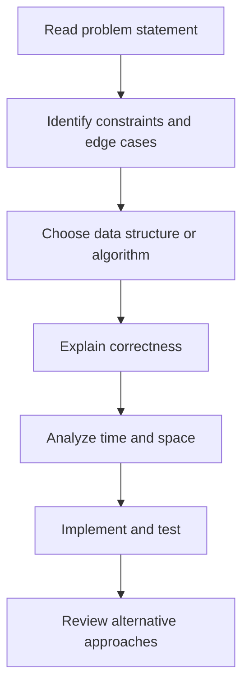

# Coding Interview Practice — NeetCode Submissions

This repository stores coding-problem submissions synchronized from [NeetCode](https://neetcode.io). It is a practice archive rather than a standalone application.

## Purpose

- Practice data structures and algorithms
- Review solutions before technical interviews
- Build consistency with problem-solving and complexity analysis
- Track progress across topics and languages

## Repository organization

Submissions are grouped by topic and problem. Exact folder and file names are generated by the NeetCode GitHub Sync integration and may change as new submissions are added.

Example structure:

```text
topic/
└── problem-name/
    └── submission-0.py
```

## Languages

The repository may contain submissions in multiple languages. For Python backend interviews, prioritize reviewing the `.py` solutions and add personal notes for the problems you have independently understood.

## How synchronization works

Manage sync preferences through your NeetCode account's GitHub integration. The integration can automatically commit submissions and may support syncing previous solutions. See [NeetCode](https://neetcode.io) for current integration details.

## Recommended review routine

For each important problem, record:
- The main idea and why it works
- Time complexity
- Space complexity
- Edge cases
- An alternative approach, if useful

Do not treat a synchronized submission as proof of mastery until you can explain and reproduce the solution independently.

## Relevance to backend roles

Algorithm practice supports technical interview preparation. For a Python Backend Developer portfolio, this repository complements—rather than replaces—projects demonstrating REST APIs, database design, authentication, testing, and deployment.

## Author

**Kirubanandhan V** · [GitHub](https://github.com/kirubanandhan016) · [Portfolio](https://kirubanandhan016.github.io/)


## Problem-solving workflow



For each solution, keep a short note with the pattern used (for example, two pointers, sliding window, binary search, DFS/BFS, heap, or dynamic programming), complexity, and edge cases. Add notes only after independently understanding the solution.

